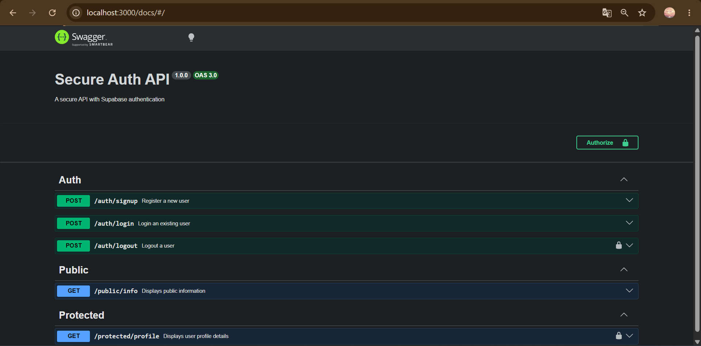

# Secure Auth API

A RESTful API built with Node.js and Express that handles user authentication using Supabase Auth. It supports user registration, login, and logout, and protects private endpoints using JSON Web Tokens (JWTs). Token verification is handled via reusable Express middleware, and all endpoints are documented and testable through Swagger UI.

---

## Setup

### Prerequisites
- Node.js v18+
- A free [Supabase](https://supabase.com) account

### Steps

1. Clone the repository:
   ```bash
   git clone https://github.com/YOUR-USERNAME/Secure-API.git
   cd Secure-API
   ```

2. Install dependencies:
   ```bash
   npm install
   ```

3. Create a `.env` file in the project root:
   ```
   SUPABASE_URL=your_project_url
   SUPABASE_KEY=your_anon_key
   PORT=3000
   ```

4. Find your `SUPABASE_URL` and `SUPABASE_KEY` in your Supabase Dashboard under **Project Settings → API**.

---

## How to Run

**Development** (auto-restarts on file changes):
```bash
npm run dev
```

**Production:**
```bash
npm start
```

The server will start on `http://localhost:3000` and log:
```
Server running and connected to Supabase
```

---

## API Reference

| Method | Endpoint | Auth Required | Description |
|--------|----------|:-------------:|-------------|
| POST | `/auth/signup` | No | Register a new user account |
| POST | `/auth/login` | No | Log in and receive a JWT access token |
| POST | `/auth/logout` | Yes | Terminate the current user session |
| GET | `/public/info` | No | Returns public information |
| GET | `/protected/profile` | Yes | Returns the authenticated user's profile |
| GET | `/protected/dashboard` | Yes | Returns a protected dashboard message |

Protected routes require an `Authorization` header in the format:
```
Authorization: Bearer <your_access_token>
```

---

## Swagger UI

Interactive API documentation is available at:
```
http://localhost:3000/docs
```

To test protected routes in Swagger:
1. Call `POST /auth/login` to get an access token
2. Click the **Authorize** button (top right)
3. Paste your token in the value field (without the `Bearer ` prefix)
4. Click Authorize — all protected routes are now unlocked for testing



---

## Environment Variables

| Variable | Description |
|----------|-------------|
| `SUPABASE_URL` | Your Supabase project URL |
| `SUPABASE_KEY` | Your Supabase anon/publishable key |
| `PORT` | Port the server listens on (default: 3000) |

> ⚠️ The `.env` file is listed in `.gitignore` and must **never** be committed to version control. Never share your Supabase keys publicly.

---

## Tech Stack

- **Runtime:** Node.js v24
- **Framework:** Express v5
- **Authentication:** Supabase Auth (JWT)
- **API Docs:** Swagger UI (`swagger-ui-express`)
