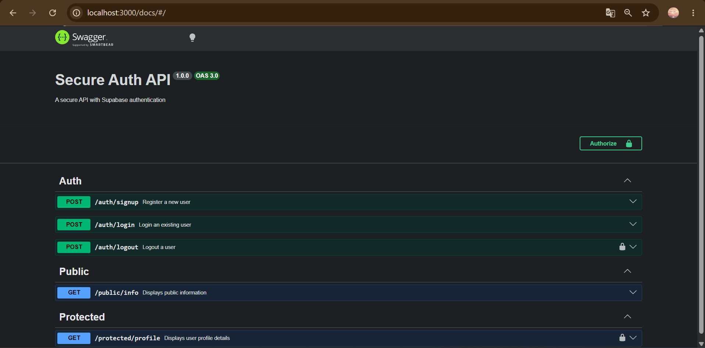

# Secure Auth API

A RESTful API built with Node.js and Express that handles user authentication using Supabase Auth. It supports user registration, login, and logout, and protects private endpoints using JSON Web Tokens (JWTs). Token verification is handled via reusable Express middleware, and all endpoints are documented and testable through Swagger UI.

---

## Setup

### Prerequisites
- Node.js v18+
- A free [Supabase](https://supabase.com) account

### Steps

1. Clone the repository:
   ```bash
   git clone https://github.com/YOUR-USERNAME/Secure-API.git
   cd Secure-API
   ```

2. Install dependencies:
   ```bash
   npm install
   ```

3. Create a `.env` file in the project root:
   ```
   SUPABASE_URL=your_project_url
   SUPABASE_KEY=your_anon_key
   PORT=3000
   ```

4. Find your `SUPABASE_URL` and `SUPABASE_KEY` in your Supabase Dashboard under **Project Settings → API**.

---

## How to Run

**Development** (auto-restarts on file changes):
```bash
npm run dev
```

**Production:**
```bash
npm start
```

The server will start on `http://localhost:3000` and log:
```
Server running and connected to Supabase
```

---

## API Reference

| Method | Endpoint | Auth Required | Description |
|--------|----------|:-------------:|-------------|
| POST | `/auth/signup` | No | Register a new user account |
| POST | `/auth/login` | No | Log in and receive a JWT access token |
| POST | `/auth/logout` | Yes | Terminate the current user session |
| GET | `/public/info` | No | Returns public information |
| GET | `/protected/profile` | Yes | Returns the authenticated user's profile |
| GET | `/protected/dashboard` | Yes | Returns a protected dashboard message |

Protected routes require an `Authorization` header in the format:
```
Authorization: Bearer <your_access_token>
```

---

## Swagger UI

Interactive API documentation is available at:
```
http://localhost:3000/docs
```

To test protected routes in Swagger:
1. Call `POST /auth/login` to get an access token
2. Click the **Authorize** button (top right)
3. Paste your token in the value field (without the `Bearer ` prefix)
4. Click Authorize — all protected routes are now unlocked for testing



---

## Environment Variables

| Variable | Description |
|----------|-------------|
| `SUPABASE_URL` | Your Supabase project URL |
| `SUPABASE_KEY` | Your Supabase anon/publishable key |
| `PORT` | Port the server listens on (default: 3000) |

> ⚠️ The `.env` file is listed in `.gitignore` and must **never** be committed to version control. Never share your Supabase keys publicly.

---

## Tech Stack

- **Runtime:** Node.js v24
- **Framework:** Express v5
- **Authentication:** Supabase Auth (JWT)
- **API Docs:** Swagger UI (`swagger-ui-express`)

---

## ★ Stage 7 — AI Rematch

I gave an AI assistant the following prompt and asked it to build the same API from scratch:

> Build a Node.js + Express API for authentication using @supabase/supabase-js. Use signUp, signInWithPassword, getUser, and signOut. Status codes: 201 signup, 200 login, 204 logout, 400 missing fields, 401 bad/missing token. Use const { data, error } destructuring for all Supabase calls. Tokens are passed as Authorization: Bearer <token>. Extract and verify the token in reusable middleware and attach the verified user to req.user.

### What the AI got right
- All status codes were correct (201, 200, 204, 400, 401)
- Used `{ data, error }` destructuring correctly on all Supabase calls
- Extracted token verification into a reusable middleware and attached user to `req.user`
- Filtered the profile response to only `id`, `email`, and `created_at`
- Separated files cleanly into config, routes, and middleware layers

### What the AI did differently

**Input validation as separate middleware**
Instead of checking `if (!email || !password)` inside each route handler, the AI created a separate `validateRequiredFields(['email', 'password'])` middleware. This is more reusable and scalable across many routes, though my approach is simpler and equally valid for a small API.

**Security flaw — leaking error details on login failure**
My login handler returns a single generic message: `{ "error": "Invalid login credentials" }`. The AI returned: `{ "error": "Invalid email or password.", "details": error.message }`. Leaking the raw Supabase error message in `details` reveals whether the email or password was wrong, which helps attackers enumerate valid accounts. Generic messages are intentionally vague for security.

**Security flaw — overly specific middleware error messages**
My middleware returns the same `"Access token required"` for all header problems. The AI returned different messages for each failure case (missing header, wrong format, empty token). Specific messages tell attackers exactly what is wrong with their request. Generic messages are the more secure choice.

**Supabase client config — `persistSession: false`**
The AI added server-side Supabase client options I didn't specify: `persistSession: false` and `autoRefreshToken: false`. Since each request carries its own token, the server doesn't need to store session state. This is a good production practice my prompt didn't mention and my implementation missed.

**JSDoc Swagger comments vs a standalone `openapi.json`**
I documented my API in a separate `src/docs/openapi.json` file. The AI wrote `@swagger` JSDoc comments directly above each route. The JSDoc approach keeps documentation next to the code it describes, making it easier to keep in sync. My JSON file approach is more explicit and readable as a standalone document.

**Missing 404 and global error handlers**
The AI added a catch-all 404 handler and a global error handler in `server.js`. Without these, Express returns an HTML error page for unknown routes instead of JSON — inconsistent with an API. These are good production practices my implementation is missing.

### What my prompt missed
My prompt did not mention `persistSession: false`, 404 handling, or a global error handler. The AI made good assumptions on all three. The security flaws in the AI's output came from the AI's own choices, not from anything I omitted — which shows that even with a detailed prompt, an AI can introduce subtle security issues that require a human review to catch.
